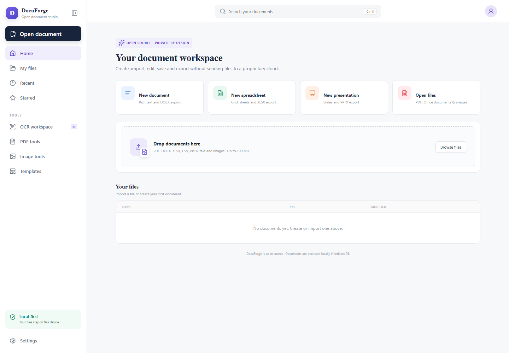

# DocuForge

**A local-first document workspace for office files, advanced PDF workflows, and optional on-device OCR.**

[](#project-status)
[](https://github.com/priyan2075887/docuforge/actions/workflows/ci.yml)
[](LICENSE)
[](apps/web)
[](services/api)

DocuForge brings a browser-persistent file library, a rich-text Writer, spreadsheet and presentation workspaces, PDF organization, and local OCR orchestration into one open-source project. It is designed for a trusted user working on their own machine: normal editing data stays in the browser, and PDF/OCR operations are sent only to the local API.

> [!IMPORTANT]
> DocuForge is an **active alpha**, not a production office suite or hardened document-processing service. The API has no authentication, authorization, tenant isolation, rate limiting, or hostile-file sandbox. Keep it bound to `127.0.0.1`; do not expose it to a LAN, the internet, a reverse proxy, or untrusted users.



## What works today

| Area | Current capability |
| --- | --- |
| Local library | Import, create, reopen, rename, delete, and save documents in browser IndexedDB |
| Writer | Rich-text editing with headings, typography, color, highlighting, alignment, lists, task lists, tables, images, links, code blocks, search, layout controls, and document statistics |
| Spreadsheets | CSV/XLSX import, multi-sheet cell editing, and XLSX export |
| Presentations | Slide creation, thumbnails, colors, presentation mode, and PPTX export |
| File viewing | Browser PDF/image viewing and original-file download |
| PDF Studio | Preview-first page mixing, selection, reordering, rotation, deletion, duplication, blank pages, undo/redo, keyboard controls, alternating two-PDF mixes, zoom, lazy thumbnails, and a virtualized page grid |
| PDF workflows | Dedicated organize, merge, and split pages plus extract, delete, rotate, reorder, structural optimization, and image-to-PDF API operations |
| Local OCR | Embedded-text inspection and optional PaddleOCR/PP-OCRv5 recognition for pages that appear scanned |
| Export | DOCX, XLSX, and PPTX export for the currently supported editor models; generated PDFs can be previewed, downloaded, or saved back to the browser library |

PDF composition is manifest-driven and non-destructive: source pages from several PDFs can be mixed, duplicated, rotated, or combined with blank pages in one request. A result is generated only after confirmation, and source files are not overwritten.

## Quick start

### Prerequisites

- Git
- A Node.js release supported by Vite 8, with npm
- Python 3.11 or 3.12
- A current Chromium-, Firefox-, or Safari-based browser with IndexedDB enabled

### 1. Install the local API

From the repository root in PowerShell:

```powershell
cd services/api
python -m venv .venv
.venv\Scripts\python -m pip install --upgrade pip
.venv\Scripts\python -m pip install -r requirements.txt
cd ../..
```

### 2. Install the web application

```powershell
cd apps/web
npm.cmd install
cd ../..
```

### 3. Start DocuForge

On Windows, double-click `start-docuforge.cmd` or run:

```powershell
.\start-docuforge.cmd
```

This opens the API at `http://127.0.0.1:8000` and the web application at `http://localhost:5173`. Keep both terminal windows open while using PDF or OCR features.

For manual startup, run these in separate terminals:

```powershell
cd services/api
.venv\Scripts\python -m uvicorn app.main:app --reload --host 127.0.0.1 --port 8000
```

```powershell
cd apps/web
npm.cmd run dev
```

The Vite development server proxies browser requests under `/api` to the local FastAPI service. Interactive API documentation is available at `http://127.0.0.1:8000/docs`.

## Optional PaddleOCR

The standard installation supports PDF editing and embedded-text inspection without installing an OCR model. To recognize scanned pages, install the isolated PaddleOCR environment:

```powershell
cd services/api
.venv\Scripts\python -m pip install -r requirements-ocr-paddle.txt
```

The pinned optional stack uses PaddleOCR 3.7.0, PaddlePaddle 3.2.2, and PP-OCRv5. Model files are not committed to this repository and may be downloaded into Paddle's user cache on first use. The current provider is configured for English, runs synchronously, and returns extracted text and line metadata; it does not yet create a searchable text layer inside the PDF.

PaddleOCR is optional because its runtime is large and platform support differs. Review the licenses and redistribution terms of application code, dependencies, and model weights separately before packaging or redistributing them.

## Architecture at a glance

```text
Browser
  React + TypeScript editors
  IndexedDB document library
  PDF.js preview and thumbnails
          |
          | localhost only (/api proxy)
          v
FastAPI service
  document inspection and development storage
  pypdf structure, metadata, and native text extraction
  pypdfium2 rasterization for OCR candidate pages
  optional PaddleOCR through Pillow images
```

The project is intentionally split into independently testable workspaces:

```text
apps/web/             React, TypeScript, Vite, editors, viewers, and IndexedDB
services/api/         FastAPI, PDF operations, inspection, and OCR orchestration
docs/ARCHITECTURE.md  Data flows, boundaries, and design decisions
storage/              Ignored local API document storage; never source-controlled
```

Read [the architecture guide](docs/ARCHITECTURE.md) for the component map, PDF manifest flow, OCR routing, persistence boundaries, and current security model. API setup and endpoint details live in [the service guide](services/api/README.md).

## Privacy and security model

- The primary **My files** library is stored in the current browser profile's IndexedDB database. It is not an account, cloud backup, encrypted vault, or cross-browser sync service.
- PDF and OCR actions upload the selected bytes to the API running on the same machine. Those operations are normally processed in memory.
- The API's development document-storage endpoints write separate copies under the ignored `storage/documents/` directory. They are not the browser library and are not automatically synchronized with it.
- OCR model weights live in the OCR framework's user cache, outside this repository.
- DocuForge intentionally includes no analytics or remote inference service. Browser extensions, operating-system backups, and locally installed software remain outside its trust boundary.
- Imported documents are complex, untrusted input. Until parser isolation, authentication, quotas, resource controls, and security review are complete, use only documents you trust.

See [SECURITY.md](SECURITY.md) for private vulnerability reporting and the supported-version policy.

## Interoperability limits

DocuForge does not yet offer lossless round-tripping for every office format or feature.

- DOCX import/export covers common text structure and formatting, not exact Word pagination, tracked changes, comments, footnotes, fields, citations, mail merge, macros, or all floating-layout constructs.
- Spreadsheet editing is a practical grid, not a complete Excel-compatible formula, chart, pivot-table, macro, or recalculation engine.
- Presentation import is not yet a full PPTX-to-editable-slide reconstruction pipeline; advanced layouts, animation, transitions, media, and master fidelity remain limited.
- Legacy DOC/XLS/PPT and OpenDocument files may be retained without becoming fully editable; a conversion service is not bundled.
- Password-protected PDFs are not supported. Signatures, forms, annotations, redaction guarantees, PDF/A conformance, and every metadata/outline construct are not preserved in every transformation.
- PDF optimization is structural/lossless where possible; it is not presented as aggressive image recompression.
- OCR accuracy varies with language, scan quality, layout, handwriting, tables, and model support. Always review recognized text before relying on it.

These boundaries are part of the product contract. Please report reproducible fidelity problems using synthetic or redistributable documents, never confidential files.

## Validation

Run the checks for each workspace you change:

```powershell
cd apps/web
npm.cmd run lint
npm.cmd run build
```

```powershell
cd services/api
.venv\Scripts\python -m pip install -r requirements-dev.txt
.venv\Scripts\python -m pytest -q
```

The API suite exercises health and local storage behavior, PDF range validation, merge, atomic composition, damaged-input rejection, extraction, deletion, rotation, reordering, splitting, and structural optimization. UI changes should also be exercised manually with small synthetic documents across loading, empty, success, failure, keyboard, and narrow-screen states.

Passing tests demonstrate covered behavior; they are not a security certification or a guarantee of general document fidelity.

## Project status and roadmap

DocuForge is under active development. There is no stable release, hosted service, migration guarantee, or compatibility promise yet.

Near-term priorities are:

1. Expand regression coverage for the permissive pypdf/pypdfium2 backend across more real-world PDF structures.
2. Harden input handling with aggregate limits, timeouts, cancellation, bounded concurrency, temporary-file isolation, and parser threat testing.
3. Add PDF annotations, forms, verified redaction, page labels/outlines, searchable-PDF export, and structured OCR outputs.
4. Improve DOCX/XLSX/PPTX and OpenDocument fidelity while documenting every intentional conversion loss.
5. Add accessibility audits, localization, desktop packaging, offline model management, and reproducible release artifacts.
6. Design collaboration only after authentication, authorization, conflict resolution, and an explicit non-local trust model exist.

## Contributing

Contributions are welcome. Start with [CONTRIBUTING.md](CONTRIBUTING.md), follow the [Code of Conduct](CODE_OF_CONDUCT.md), and use synthetic fixtures instead of private documents. Broad architecture changes, new model providers, and heavyweight dependencies should be discussed before implementation because they affect interoperability, security, licensing, and distribution size.

Maintainers preparing a source or packaged release should also follow the
[release checklist](docs/RELEASE_CHECKLIST.md).

## Independence and trademarks

DocuForge is an original project. It is not affiliated with, endorsed by, derived from, or a drop-in replacement for WPS Office, Microsoft Office, iLovePDF, or their owners. Those names and marks belong to their respective owners. DocuForge may study publicly observable document-workflow conventions and independently developed open-source projects, but it does not copy proprietary code, assets, branding, or exact trade dress.

## License

DocuForge application code in this repository is licensed under the [MIT License](LICENSE). Third-party packages, optional OCR runtimes, model weights, fonts, sample files, and datasets retain their own licenses and may impose different conditions. See [THIRD_PARTY_NOTICES.md](THIRD_PARTY_NOTICES.md) for the current direct-dependency inventory and PDFium redistribution note.
