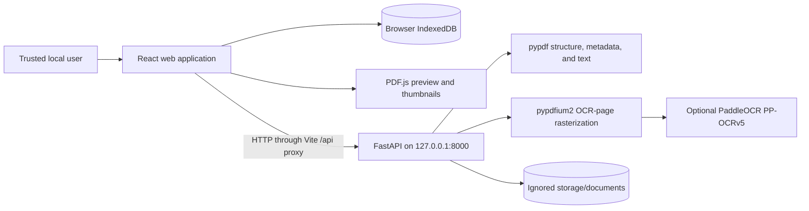
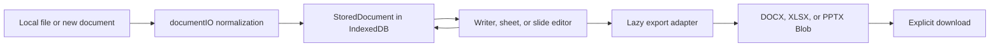
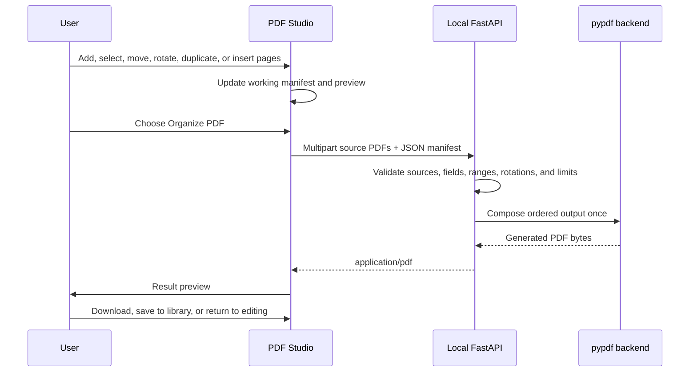
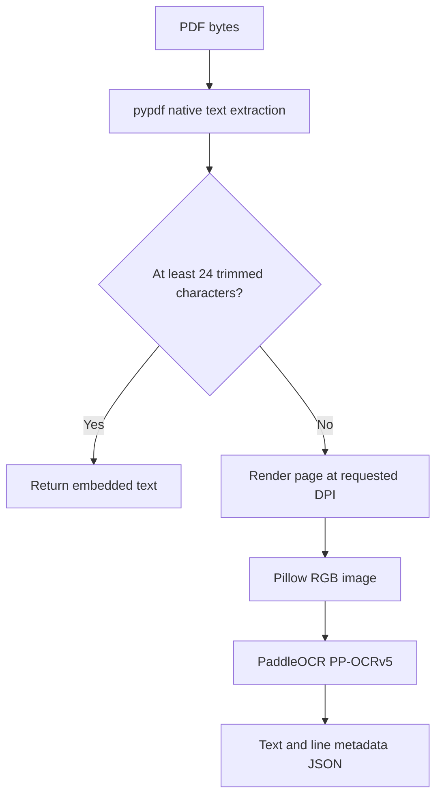

# DocuForge architecture

This document describes the architecture of the current DocuForge alpha, including its trust boundaries and known gaps. It is a description of the repository as implemented, not a promise of WPS Office, Microsoft Office, or iLovePDF compatibility.

## Design goals

DocuForge is organized around five principles:

1. **Local first:** ordinary editing state belongs to the user's browser profile, and document-processing services run on the same device.
2. **Preview before output:** PDF tools modify an in-memory working model; generation, download, and library save are explicit actions.
3. **Originals are preserved:** transformations create new output instead of silently replacing source bytes.
4. **Capability boundaries are visible:** unsupported fidelity, optional models, and alpha security limitations are documented rather than hidden.
5. **License-visible core dependencies:** pypdf handles PDF structure and native text, while pypdfium2 rasterizes OCR candidate pages; PDFium's bundled notices and optional OCR artifacts are reviewed separately from DocuForge's MIT license.

## Repository map

```text
DocuForge/
├── apps/
│   └── web/                  React + TypeScript + Vite client
│       └── src/
│           ├── App.tsx       workspace shell, history routing, library actions
│           ├── storage.ts    IndexedDB persistence boundary
│           ├── documentIO.ts office-file import normalization
│           ├── writerExport.ts
│           └── components/   editors, viewers, and PDF workspaces
├── services/
│   └── api/
│       ├── app/main.py       FastAPI application, inspection, storage, OCR routes
│       ├── app/pdf_tools.py  validated structural PDF operations
│       ├── app/routers/pdf.py
│       ├── app/ocr/          optional OCR provider adapters
│       └── tests/            API and PDF regression tests
├── storage/                  ignored local development storage
└── start-docuforge.cmd       Windows development launcher
```

## Runtime topology



The intended deployment is one trusted user, one browser profile, and one local API process. The API is not an internet service. It does not currently authenticate callers or isolate users, jobs, documents, or parsing processes.

During development, Vite serves the frontend at `http://localhost:5173`. Requests whose browser URL begins with `/api` are proxied to `http://localhost:8000` with the first `/api` prefix removed. For example, a browser request to `/api/api/v1/pdf/compose` reaches FastAPI as `/api/v1/pdf/compose`.

## Web application

### Application shell and routing

`App.tsx` owns the workspace shell, the active document, library refreshes, and lightweight browser-history routes. Editors and heavyweight format libraries are loaded on demand so the home screen does not eagerly download PDF.js, ExcelJS, DOCX, and PPTX tooling.

Current restorable routes include:

```text
/document/<document-id>
/pdf/<document-id>/organize
/pdf/<document-id>/merge
/pdf/<document-id>/split
```

These are client-side history routes served by the Vite development fallback. A future production host must be configured to return the application entry point for these paths.

### Browser document model

The current shared browser record is deliberately small:

```ts
type StoredDocument = {
  id: string
  name: string
  kind: 'writer' | 'sheet' | 'slides' | 'pdf' | 'image'
  mimeType: string
  size: number
  createdAt: string
  updatedAt: string
  data?: ArrayBuffer
  content?: string
  starred?: boolean
}
```

`storage.ts` stores these records in IndexedDB database `docuforge`, version `1`, object store `documents`. An `updatedAt` index exists, while listing currently loads the records and sorts them newest-first in application code.

IndexedDB is the primary **My files** persistence layer. Its scope and lifetime are controlled by the browser profile. Clearing site data, private-browsing behavior, browser storage eviction, or using another origin/profile can make the library unavailable. DocuForge does not currently provide account sync, encryption at rest, recovery, schema migrations beyond version 1, or automatic backup.

### Office editing flow



The editors use pragmatic internal models rather than implementing the full OOXML or OpenDocument standards. Import and export are therefore conversions with documented fidelity limits, not lossless round trips.

## PDF Studio

### Client working model

The organizer separates source documents from output-page instances. A page instance identifies a source/page coordinate or a blank page, then adds output-only state such as rotation and selection. Repeating the same source coordinate represents duplication without copying source bytes.

The session reducer provides immutable page operations and a bounded undo/redo history. Thumbnail data is cached outside history snapshots so undo does not repeatedly copy large data URLs. The page canvas uses lazy PDF.js rendering and a virtualized grid: only visible rows plus overscan are mounted, keeping the DOM bounded for large page counts.

Selection and transformation stay in the browser until the user confirms generation. Merge and split use their own workspaces rather than applying an operation immediately from the tools menu.

### Atomic composition flow



A source entry in the manifest uses a zero-based `source` index and a one-based `page` number:

```json
{
  "pages": [
    { "source": 0, "page": 2, "rotation": 90 },
    { "source": 1, "page": 1 },
    { "source": 0, "page": 2, "rotation": 180 },
    { "blank": { "width": 595, "height": 842 } }
  ]
}
```

Repeating an entry duplicates a page. Rotation is clockwise and must be `0`, `90`, `180`, or `270`. Blank-page dimensions are PDF points. The current service accepts at most 50 source PDFs and 5,000 manifest pages, and each uploaded multipart part is limited to 100 MiB. Those checks do not yet constitute aggregate memory, CPU-time, decompression, or output-size protection.

### Backend PDF responsibilities

The permissive backend split is:

- **pypdf:** structural reading and writing, native text extraction, page selection, merge, split, rotation, reordering, composition, metadata handling, and lossless stream/object cleanup where supported;
- **pypdfium2:** rasterization of pages that the native-text heuristic routes to OCR;
- **Pillow:** image normalization and image-to-PDF/OCR handoff;
- **PDF.js in the browser:** interactive previews and thumbnail generation.

Transformations may preserve page contents without preserving every catalog-level feature. Outlines, page labels, attachments, forms, annotations, signatures, optional-content groups, structure trees, named destinations, and metadata require operation-specific regression coverage before any preservation claim is made.

## OCR routing

OCR is intentionally optional.



The 24-character rule is a routing heuristic, not a quality score. A page can contain a poor text layer that passes the threshold, or a legitimate sparse page that is unnecessarily sent to OCR. The current provider:

- is configured for English;
- enables document orientation, unwarping, and text-line orientation stages;
- accepts 120–300 DPI through the HTTP endpoint;
- loads and caches one PaddleOCR pipeline in the API process;
- processes pages synchronously;
- returns recognized text, confidence values when available, and bounding boxes;
- does not yet write a searchable text layer back into the PDF.

Model artifacts are not bundled. First use may download weights to Paddle's cache. Model code, runtime, weights, and training data have separate provenance and licenses and must be reviewed separately for redistribution.

## Persistence boundaries

DocuForge currently has three distinct local persistence locations:

| Store | Owner | Contents | Lifecycle |
| --- | --- | --- | --- |
| Browser IndexedDB | Web origin/profile | `StoredDocument` records, editable content, and imported bytes | Browser-controlled; primary UI library |
| `storage/documents/` | FastAPI development service | UUID-named binary uploads plus JSON metadata | Local filesystem; ignored by Git |
| Paddle/PaddleX cache | OCR runtime | Downloaded model files and runtime cache | Tool-controlled; outside repository |

The IndexedDB library and API filesystem store are not synchronized. The API document endpoints are an early local-service capability, not a multi-user document repository. There is currently no API deletion endpoint, retention policy, encryption layer, or background cleanup job.

## Trust and security boundaries

The alpha assumes the caller, browser, local API process, and selected documents belong to one trusted user. Current controls include filename basename normalization, per-upload size checks, page/manifest validation, loopback startup in the Windows launcher, and development CORS restricted to `http://localhost:5173`.

Important missing controls include:

- authentication, authorization, sessions, and tenancy;
- CSRF design for a deployed service and robust origin enforcement outside development;
- parser sandboxing or worker-process isolation;
- aggregate input/output limits, archive/decompression limits, CPU/memory quotas, and concurrency bounds;
- request deadlines, job cancellation, queues, and backpressure;
- malware scanning, content-disarm/reconstruction, and signed dependency/model updates;
- audit logging designed not to leak filenames, document text, or local paths;
- encrypted storage, secret management, backups, and retention controls.

For these reasons, the API must remain on `127.0.0.1` and must not be exposed through `0.0.0.0`, a router port-forward, tunnel, container ingress, public cloud service, or shared workstation service. CORS is a browser policy and is not API authentication.

## Error and resource model

The API reads uploads into memory, validates them, and returns generated output as a streamed response backed by in-memory bytes. This makes the current implementation easy to reason about but creates memory pressure for large inputs and concurrent calls. OCR is CPU-heavy and synchronous. Closing browser dialogs does not currently guarantee backend cancellation.

Expected input problems are translated to actionable HTTP errors:

- `413` for the current per-file upload limit;
- `415` when inspection receives a non-PDF;
- `422` for invalid PDFs, manifests, ranges, dimensions, or rotations;
- `503` when OCR is requested without PaddleOCR installed.

Unexpected parser/runtime failures still need a consistent public-safe error boundary and structured logging policy.

## Validation strategy

The web workspace uses TypeScript compilation through the production build plus Oxlint. The API uses pytest and FastAPI's test client with synthetic PDFs. Existing tests cover the health route, development storage, file-type rejection, native text and page dimensions, PDFium rasterization for OCR, page-range parsing, PDF merging, atomic mixed-source composition, duplicates, independent rotations, blank pages, metadata and annotation carryover, encrypted and damaged inputs, extraction, deletion, reordering, splitting, structural optimization, and image-to-PDF conversion.

Validation commands are documented in the root README and [contributor guide](../CONTRIBUTING.md). Tests should assert properties of the generated document—such as page count, page order, rotation, native text, and expected failures—not only HTTP status codes.

Coverage still needs to expand across encrypted inputs, annotations, forms, outlines, attachments, page labels, malformed cross-reference structures, huge object graphs, images with unusual color profiles, OCR cancellation, and browser-level accessibility/regression scenarios.

## Evolution boundaries

Before DocuForge can support a hosted or collaborative deployment, it needs a different security and data architecture. Authentication cannot be added safely as a thin wrapper around the current singleton process. A multi-user design must define tenant-scoped object storage, authorization at every document/job boundary, isolated asynchronous workers, quotas, retention, audit policy, encryption, observability, and conflict resolution.

Similarly, office-suite fidelity requires explicit internal document models and format-specific conformance fixtures rather than accumulating one-off import patches. The current editors are useful alpha workspaces, not implementations of the complete OOXML, OpenDocument, PDF, or HTML standards.

## Related documentation

- [Project guide](../README.md)
- [API guide](../services/api/README.md)
- [Contributing](../CONTRIBUTING.md)
- [Security policy](../SECURITY.md)
- [MIT license](../LICENSE)
- [Third-party notices](../THIRD_PARTY_NOTICES.md)

## Independence statement

DocuForge is independently implemented and is not affiliated with WPS Office, Microsoft Office, iLovePDF, or their owners. Familiar workflow concepts do not imply use of proprietary source code, visual assets, branding, or exact trade dress.
